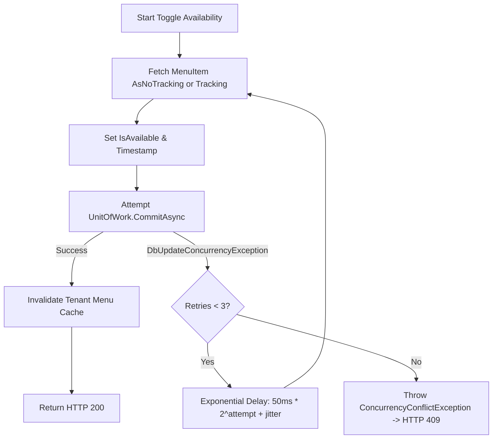

# Data Model & Interface Contracts: Repositories and Unit of Work

## 1. Domain Interface Contracts

### 1.1 `IUnitOfWork`
Located at: `src/RestoCore.Application/Common/Interfaces/IUnitOfWork.cs`

```csharp
namespace RestoCore.Application.Common.Interfaces;

public interface IUnitOfWork
{
    Task<int> CommitAsync(CancellationToken cancellationToken = default);
    Task BeginTransactionAsync(CancellationToken cancellationToken = default);
    Task CommitTransactionAsync(CancellationToken cancellationToken = default);
    Task RollbackTransactionAsync(CancellationToken cancellationToken = default);
}
```

---

### 1.2 `ICatalogRepository`
Located at: `src/RestoCore.Application/Common/Interfaces/Repositories/ICatalogRepository.cs`

Manages: `Category`, `MenuItem`, `ModifierGroup`, `ModifierOption`.

```csharp
namespace RestoCore.Application.Common.Interfaces.Repositories;

using RestoCore.Domain.Entities;

public interface ICatalogRepository
{
    Task<Category?> GetCategoryByIdAsync(Guid id, CancellationToken cancellationToken = default);
    Task<bool> CategoryExistsAsync(string name, CancellationToken cancellationToken = default);
    void AddCategory(Category category);
    void RemoveCategory(Category category);

    Task<MenuItem?> GetMenuItemByIdAsync(Guid id, CancellationToken cancellationToken = default);
    Task<MenuItem?> GetMenuItemWithModifiersAsync(Guid id, CancellationToken cancellationToken = default);
    void AddMenuItem(MenuItem menuItem);
    void RemoveMenuItem(MenuItem menuItem);

    Task<ModifierGroup?> GetModifierGroupByIdAsync(Guid id, CancellationToken cancellationToken = default);
    void AddModifierGroup(ModifierGroup modifierGroup);
    void RemoveModifierGroup(ModifierGroup modifierGroup);

    Task<PublicMenuDto?> GetPublicCatalogAsync(string tenantSlug, string? tableToken, CancellationToken cancellationToken = default);
}
```

---

### 1.3 `IKitchenRepository`
Located at: `src/RestoCore.Application/Common/Interfaces/Repositories/IKitchenRepository.cs`

Manages: Concurrency-resilient availability toggles and kitchen items.

```csharp
namespace RestoCore.Application.Common.Interfaces.Repositories;

using RestoCore.Domain.Entities;

public interface IKitchenRepository
{
    Task<MenuItem?> GetItemForAvailabilityToggleAsync(Guid itemId, CancellationToken cancellationToken = default);
    Task<bool> UpdateItemAvailabilityWithRetryAsync(
        Guid itemId, 
        bool isAvailable, 
        int maxRetries = 3, 
        CancellationToken cancellationToken = default);
}
```

---

### 1.4 `IMenuLayoutRepository`
Located at: `src/RestoCore.Application/Common/Interfaces/Repositories/IMenuLayoutRepository.cs`

Manages: Canvas layouts and `MenuPublishJob` state transitions.

```csharp
namespace RestoCore.Application.Common.Interfaces.Repositories;

using RestoCore.Domain.Entities;

public interface IMenuLayoutRepository
{
    Task<MenuPublishJob?> GetPublishJobByIdAsync(Guid jobId, CancellationToken cancellationToken = default);
    void AddPublishJob(MenuPublishJob job);
    Task<List<MenuItem>> GetPublishedMenuItemsAsync(CancellationToken cancellationToken = default);
    Task<List<Category>> GetPublishedCategoriesAsync(CancellationToken cancellationToken = default);
    Task UpdateJobStatusAsync(Guid jobId, JobStatus status, string? errorDetails = null, CancellationToken cancellationToken = default);
}
```

---

### 1.5 `ITenantRepository`
Located at: `src/RestoCore.Application/Common/Interfaces/Repositories/ITenantRepository.cs`

Manages: `Tenant`, `Table`, and Branding configuration.

```csharp
namespace RestoCore.Application.Common.Interfaces.Repositories;

using RestoCore.Domain.Entities;

public interface ITenantRepository
{
    Task<Tenant?> GetCurrentTenantAsync(CancellationToken cancellationToken = default);
    Task<Tenant?> GetTenantBySlugAsync(string slug, CancellationToken cancellationToken = default);
    Task<bool> SlugExistsAsync(string slug, CancellationToken cancellationToken = default);
    void AddTenant(Tenant tenant);

    Task<Table?> GetTableByNumberAsync(int tableNumber, CancellationToken cancellationToken = default);
    Task<Table?> GetTableByTokenAsync(string token, CancellationToken cancellationToken = default);
    void AddTable(Table table);
}
```

---

## 2. Infrastructure Entity Framework Implementations

All repositories will be implemented in `RestoCore.Infrastructure/Persistence/Repositories/` and injected with `ApplicationDbContext`.

- `CatalogRepository : ICatalogRepository`
- `KitchenRepository : IKitchenRepository`
- `MenuLayoutRepository : IMenuLayoutRepository`
- `TenantRepository : ITenantRepository`
- `UnitOfWork : IUnitOfWork` (wraps `_context.SaveChangesAsync()` and `IDbContextTransaction`)

---

## 3. Concurrency Strategy: Retry with Exponential Backoff

Inside `KitchenRepository`:


