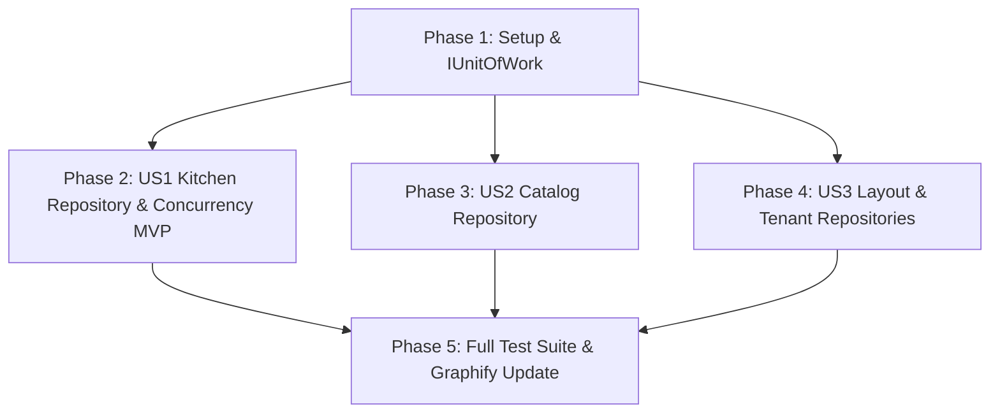

# Tasks: Repositories, Unit of Work, and Concurrency Control

**Input**: Design documents from `specs/006-repository-unitofwork-concurrency/`
**Prerequisites**: [plan.md](file:///r:/Programando/RestoCore/resto-core-back/specs/006-repository-unitofwork-concurrency/plan.md), [spec.md](file:///r:/Programando/RestoCore/resto-core-back/specs/006-repository-unitofwork-concurrency/spec.md), [research.md](file:///r:/Programando/RestoCore/resto-core-back/specs/006-repository-unitofwork-concurrency/research.md), [data-model.md](file:///r:/Programando/RestoCore/resto-core-back/specs/006-repository-unitofwork-concurrency/data-model.md)

---

## Format: `[ID] [P?] [Story] Description`
- **[P]**: Can run in parallel (different files, no blocking dependencies).
- **[Story]**: Associated user story (US1: Kitchen Concurrency, US2: Catalog Repositories, US3: Canvas Layout Repository).

---

## Phase 1: Setup & Foundational Contracts

**Purpose**: Define common contracts, `IUnitOfWork`, and repository interfaces without touching existing handlers yet.

- [x] T001 [P] Create repository directory structures in `src/RestoCore.Application/Common/Interfaces/Repositories` and `src/RestoCore.Infrastructure/Persistence/Repositories`.
- [x] T002 [P] Create `IUnitOfWork` interface in `src/RestoCore.Application/Common/Interfaces/IUnitOfWork.cs`.
- [x] T003 [P] Implement `UnitOfWork` wrapping `ApplicationDbContext` in `src/RestoCore.Infrastructure/Persistence/UnitOfWork.cs`.
- [x] T004 [P] Register `IUnitOfWork` in DI in `src/RestoCore.Infrastructure/DependencyInjection.cs`.

---

## Phase 2: User Story 1 - Kitchen Availability Updates with Concurrency Resilience (Priority: P1) 🎯 MVP

**Goal**: Isolate kitchen item toggling into `IKitchenRepository` with optimistic concurrency retry (3 attempts with exponential backoff) and migrate `ToggleItemAvailabilityCommandHandler`.

**Independent Test**: Execute concurrent toggle requests against `ToggleItemAvailabilityCommand` and verify retries succeed without exposing `DbUpdateConcurrencyException`.

### Tests for User Story 1
- [x] T005 [P] [US1] Create unit tests for `IKitchenRepository` retry behavior in `tests/RestoCore.UnitTests/Features/Kitchen/KitchenRepositoryConcurrencyTests.cs`.
- [x] T006 [P] [US1] Update `ToggleItemAvailabilityCommandHandlerTests` in `tests/RestoCore.UnitTests/Features/Kitchen/ToggleItemAvailabilityCommandHandlerTests.cs` to mock `IKitchenRepository`.

### Implementation for User Story 1
- [x] T007 [US1] Create `IKitchenRepository` interface in `src/RestoCore.Application/Common/Interfaces/Repositories/IKitchenRepository.cs`.
- [x] T008 [US1] Implement `KitchenRepository` with `UpdateItemAvailabilityWithRetryAsync` in `src/RestoCore.Infrastructure/Persistence/Repositories/KitchenRepository.cs`.
- [x] T009 [US1] Register `IKitchenRepository` in `src/RestoCore.Infrastructure/DependencyInjection.cs`.
- [x] T010 [US1] Refactor `ToggleItemAvailabilityCommandHandler` in `src/RestoCore.Application/Features/Kitchen/Commands/ToggleItemAvailabilityCommand.cs` to inject `IKitchenRepository`.

**Checkpoint**: Kitchen item availability is fully decoupled from `IApplicationDbContext` and protected against concurrency contention.

---

## Phase 3: User Story 2 - Catalog Management via Isolated Catalog Repository & Unit of Work (Priority: P2)

**Goal**: Isolate Categories, MenuItems, and ModifierGroups into `ICatalogRepository` and decouple all catalog MediatR handlers from `IApplicationDbContext`.

**Independent Test**: Run existing category, menu item, and modifier group integration tests; ensure all CRUD operations and transactional boundaries commit cleanly via `IUnitOfWork`.

### Tests for User Story 2
- [x] T011 [P] [US2] Update unit tests in `tests/RestoCore.UnitTests/Features/Categories/` to mock `ICatalogRepository` and `IUnitOfWork`.
- [x] T012 [P] [US2] Update unit tests in `tests/RestoCore.UnitTests/Features/MenuItems/` to mock `ICatalogRepository` and `IUnitOfWork`.

### Implementation for User Story 2
- [x] T013 [US2] Create `ICatalogRepository` interface in `src/RestoCore.Application/Common/Interfaces/Repositories/ICatalogRepository.cs`.
- [x] T014 [US2] Implement `CatalogRepository` in `src/RestoCore.Infrastructure/Persistence/Repositories/CatalogRepository.cs`.
- [x] T015 [US2] Register `ICatalogRepository` in `src/RestoCore.Infrastructure/DependencyInjection.cs`.
- [x] T016 [US2] Refactor `CreateCategoryCommandHandler` in `src/RestoCore.Application/Features/Categories/Commands/CreateCategoryCommand.cs` to inject `ICatalogRepository` and `IUnitOfWork`.
- [x] T017 [US2] Refactor `CreateMenuItemCommandHandler` in `src/RestoCore.Application/Features/MenuItems/Commands/CreateMenuItemCommand.cs` to inject `ICatalogRepository` and `IUnitOfWork`.
- [x] T018 [US2] Refactor `AddModifierGroupCommandHandler` in `src/RestoCore.Application/Features/MenuItems/Commands/ManageModifiersCommand.cs` to inject `ICatalogRepository` and `IUnitOfWork`.
- [x] T019 [US2] Refactor `GetPublicMenuQueryHandler` in `src/RestoCore.Application/Features/PublicMenu/Queries/GetPublicMenuQuery.cs` to inject `ICatalogRepository`.

**Checkpoint**: All Catalog handlers are decoupled from `IApplicationDbContext`.

---

## Phase 4: User Story 3 - Canvas Layout Compilation & Tenant Repositories (Priority: P3)

**Goal**: Isolate Canvas Layouts (`IMenuLayoutRepository`), `MenuPublishJob` state transitions, and Tenant management (`ITenantRepository`).

**Independent Test**: Verify canvas layout updates and compilation jobs run without holding locks on catalog tables.

### Implementation for User Story 3
- [x] T020 [P] [US3] Create `IMenuLayoutRepository` in `src/RestoCore.Application/Common/Interfaces/Repositories/IMenuLayoutRepository.cs`.
- [x] T021 [P] [US3] Create `ITenantRepository` in `src/RestoCore.Application/Common/Interfaces/Repositories/ITenantRepository.cs`.
- [x] T022 [US3] Implement `MenuLayoutRepository` in `src/RestoCore.Infrastructure/Persistence/Repositories/MenuLayoutRepository.cs`.
- [x] T023 [US3] Implement `TenantRepository` in `src/RestoCore.Infrastructure/Persistence/Repositories/TenantRepository.cs`.
- [x] T024 [US3] Register `IMenuLayoutRepository` and `ITenantRepository` in `src/RestoCore.Infrastructure/DependencyInjection.cs`.
- [x] T025 [US3] Refactor `UpdateMenuLayoutCommandHandler` and `PublishMenuCommandHandler` in `src/RestoCore.Application/Features/MenuLayout/Commands/` to use `IMenuLayoutRepository` and `IUnitOfWork`.
- [x] T026 [US3] Refactor `MenuCompilationService` in `src/RestoCore.Infrastructure/Services/Compilation/MenuCompilationService.cs` to use `IMenuLayoutRepository`.
- [x] T027 [US3] Refactor `ProvisionTenantCommandHandler` and `UpdateBrandingCommandHandler` in `src/RestoCore.Application/Features/Tenants/Commands/` to use `ITenantRepository` and `IUnitOfWork`.
- [x] T028 [US3] Refactor `GetTableQrQueryHandler` in `src/RestoCore.Application/Features/QRCodes/Queries/GetTableQrQuery.cs` to use `ITenantRepository`.

---

## Phase 5: Verification, Regressions & Graphify Re-evaluation

**Purpose**: Ensure 100% of existing test suites pass and verify the removal of `IApplicationDbContext` from the application layer.

- [x] T029 Run all unit tests (`dotnet test tests/RestoCore.UnitTests`) and verify zero regressions.
- [x] T030 Run all integration tests (`dotnet test tests/RestoCore.IntegrationTests`) and verify zero regressions.
- [x] T031 Run `graphify update .` to update the architectural graph and confirm the dismantling of the `IApplicationDbContext` God Node.

---

## Dependencies & Execution Order

