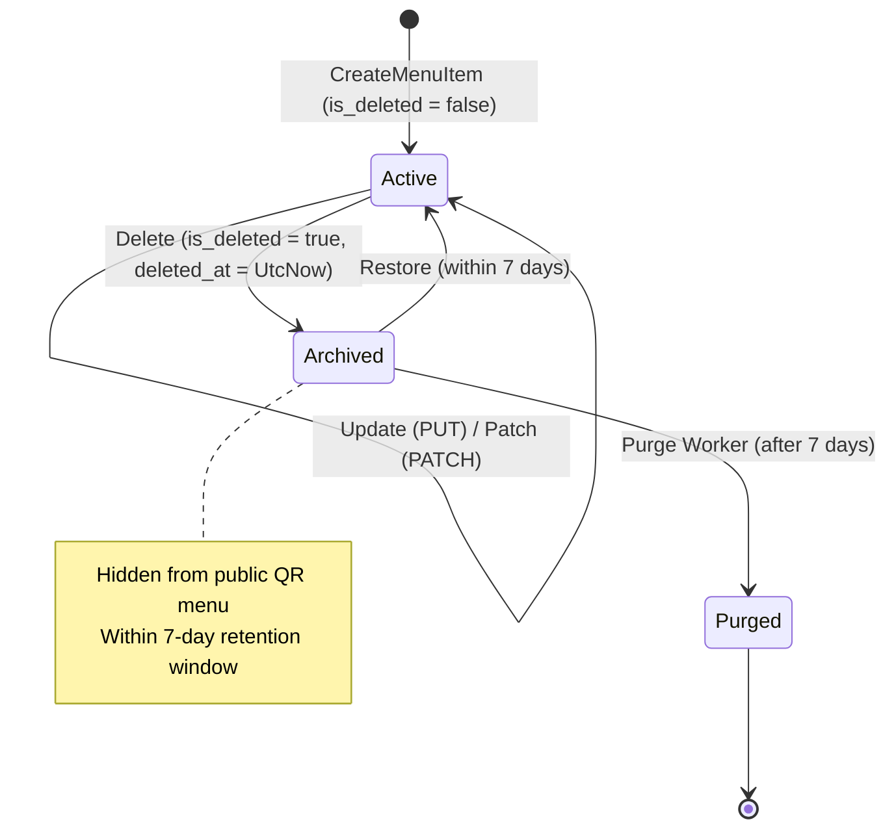

# Data Model: Menu Item CRUD, Soft Delete with 7-Day Retention, and Purge Worker

**Feature**: `008-dish-crud-soft-delete-purge`  
**Date**: 2026-10-11

---

## 1. Domain Entities & Value Objects

### `MenuItem` (`RestoCore.Domain.Entities`)
Represents an individual food item or beverage in a restaurant's catalog.

```csharp
public class MenuItem : BaseEntity, ITenantScopedEntity
{
    public Guid TenantId { get; set; }
    public Guid CategoryId { get; set; }              // Mandatory 1:N relationship
    public string Name { get; set; } = string.Empty;
    public string? Description { get; set; }
    public decimal BasePrice { get; set; }
    public bool IsAvailable { get; set; } = true;
    public string? ImageUrl { get; set; }
    public int DisplayOrder { get; set; }
    public string[] Allergens { get; set; } = Array.Empty<string>();
    public string[] DietaryLabels { get; set; } = Array.Empty<string>(); // N:M tags
    
    // Soft Delete & 7-Day Retention Window
    public bool IsDeleted { get; set; } = false;
    public DateTimeOffset? DeletedAt { get; set; }

    // Navigation Properties
    public Tenant? Tenant { get; set; }
    public Category? Category { get; set; }
    public ICollection<ModifierGroup> ModifierGroups { get; set; } = new List<ModifierGroup>();
}
```

---

## 2. PostgreSQL DDL Mapping & Indexes

```sql
-- Table: menu_items
ALTER TABLE menu_items 
ADD COLUMN is_deleted BOOLEAN NOT NULL DEFAULT false,
ADD COLUMN deleted_at TIMESTAMP WITH TIME ZONE NULL;

-- Filtered index for public menu performance (LCP budget < 2s)
CREATE INDEX idx_menu_items_active_catalog 
ON menu_items (tenant_id, category_id, display_order) 
WHERE is_deleted = false;

-- Filtered index for daily purge candidates
CREATE INDEX idx_menu_items_purge_candidates 
ON menu_items (deleted_at) 
WHERE is_deleted = true;
```

---

## 3. State Lifecycle & Transitions



### Transition Invariants
1. **Active → Archived**:
   - Condition: No orders in `queued`, `received`, `preparing`, or `ready` status reference this dish.
   - If active orders exist: Blocked with HTTP 409 Conflict.
2. **Archived → Active**:
   - Condition: `DeletedAt >= UtcNow - 7 days`.
   - Action: `IsDeleted = false`, `DeletedAt = null`.
3. **Archived → Purged**:
   - Condition: `DeletedAt < UtcNow - 7 days`.
   - Action: Permanent DB deletion + delete image file from SeaweedFS.

---

## 4. Application Models & Transfer Objects (DTOs)

### `UpdateMenuItemCommand`
```csharp
public record UpdateMenuItemCommand(
    Guid Id,
    Guid CategoryId,
    string Name,
    string? Description,
    decimal BasePrice,
    bool IsAvailable,
    string? ImageUrl,
    int DisplayOrder,
    string[] Allergens,
    string[] DietaryLabels
) : IRequest<MenuItemResponse>;
```

### `PatchMenuItemCommand`
```csharp
public record PatchMenuItemCommand(
    Guid Id,
    Guid? CategoryId,
    string? Name,
    string? Description,
    decimal? BasePrice,
    bool? IsAvailable,
    string? ImageUrl,
    int? DisplayOrder,
    string[]? Allergens,
    string[]? DietaryLabels
) : IRequest<MenuItemResponse>;
```

### `DeleteMenuItemCommand`
```csharp
public record DeleteMenuItemCommand(Guid Id) : IRequest<MenuItemArchiveResponse>;
```

### `RestoreMenuItemCommand`
```csharp
public record RestoreMenuItemCommand(Guid Id) : IRequest<MenuItemResponse>;
```

### `MenuItemArchiveResponse`
```csharp
public record MenuItemArchiveResponse(
    Guid ItemId,
    string Status,
    string Message,
    bool HasOpenOrders,
    DateTimeOffset ArchivedAt,
    int RetentionDays,
    DateTimeOffset PurgeScheduledAt
);
```
