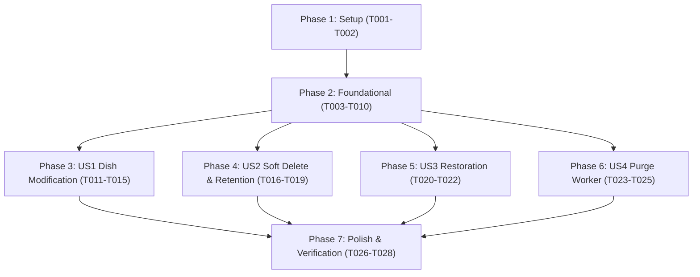

# Tasks: Menu Item CRUD, Soft Delete with 7-Day Retention, and Purge Worker

**Input**: Design documents from `specs/008-dish-crud-soft-delete-purge/`  
**Prerequisites**: [plan.md](file:///r:/Programando/RestoCore/resto-core-back/specs/008-dish-crud-soft-delete-purge/plan.md), [spec.md](file:///r:/Programando/RestoCore/resto-core-back/specs/008-dish-crud-soft-delete-purge/spec.md), [research.md](file:///r:/Programando/RestoCore/resto-core-back/specs/008-dish-crud-soft-delete-purge/research.md), [data-model.md](file:///r:/Programando/RestoCore/resto-core-back/specs/008-dish-crud-soft-delete-purge/data-model.md), [contracts/contracts.md](file:///r:/Programando/RestoCore/resto-core-back/specs/008-dish-crud-soft-delete-purge/contracts/contracts.md)  
**TDD Discipline**: Unit tests created first in `tests/RestoCore.UnitTests/` per **Constitution Principle VI**.

---

## Phase 1: Setup (Shared Infrastructure)

**Purpose**: Verification and preparation of domain models and dependencies.

- [X] T001 Verify project build and clean state with `dotnet build`
- [X] T002 Add `IsDeleted: bool` and `DeletedAt: DateTimeOffset?` to `MenuItem` in `src/RestoCore.Domain/Entities/MenuItem.cs`

---

## Phase 2: Foundational (Blocking Prerequisites)

**Purpose**: Core persistence, query filters, and repository abstractions required by all user stories.

**⚠️ CRITICAL**: Must complete before user story handlers and endpoints.

- [X] T003 Update `MenuConfiguration.cs` in `src/RestoCore.Infrastructure/Persistence/Configurations/MenuConfiguration.cs` to add filtered indices on `menu_items` for active catalog and purge candidates
- [X] T004 Configure Global Query Filter for `MenuItem` in `src/RestoCore.Infrastructure/Persistence/ApplicationDbContext.cs` (`!m.IsDeleted`)
- [X] T005 [P] Add repository methods `GetMenuItemByIdWithDeletedAsync` and `GetArchivedMenuItemsOlderThanAsync` in `src/RestoCore.Application/Common/Interfaces/Repositories/ICatalogRepository.cs`
- [X] T006 [P] Add method `HasActiveOrdersForMenuItemAsync` in `src/RestoCore.Application/Common/Interfaces/Repositories/IOrderRepository.cs`
- [X] T007 [P] Add method `DeleteObjectAsync` in `src/RestoCore.Application/Common/Interfaces/IStorageService.cs`
- [X] T008 Implement `ICatalogRepository` extensions in `src/RestoCore.Infrastructure/Persistence/Repositories/CatalogRepository.cs`
- [X] T009 Implement `IOrderRepository.HasActiveOrdersForMenuItemAsync` in `src/RestoCore.Infrastructure/Persistence/Repositories/OrderRepository.cs`
- [X] T010 Implement `IStorageService.DeleteObjectAsync` in `src/RestoCore.Infrastructure/Storage/SeaweedFsStorageService.cs`

**Checkpoint**: Foundation ready. User stories can now be implemented.

---

## Phase 3: User Story 1 - Dish Modification & Relational Validation (Priority: P1) 🎯 MVP

**Goal**: Full (`PUT`) and partial (`PATCH`) updates of dish attributes with strict 1:N category validation and N:M dietary labels.

**Independent Test**: Execute `UpdateMenuItemCommandTests` and `PatchMenuItemCommandTests`, verifying updates succeed with valid category and fail with HTTP 422/400 for non-existent categories.

### Tests for User Story 1
- [X] T011 [P] [US1] Create unit tests for `UpdateMenuItemCommandHandler` in `tests/RestoCore.UnitTests/Features/MenuItems/UpdateMenuItemCommandHandlerTests.cs`
- [X] T012 [P] [US1] Create unit tests for `PatchMenuItemCommandHandler` in `tests/RestoCore.UnitTests/Features/MenuItems/PatchMenuItemCommandHandlerTests.cs`

### Implementation for User Story 1
- [X] T013 [P] [US1] Implement `UpdateMenuItemCommand` and handler in `src/RestoCore.Application/Features/MenuItems/Commands/UpdateMenuItemCommand.cs`
- [X] T014 [P] [US1] Implement `PatchMenuItemCommand` and handler in `src/RestoCore.Application/Features/MenuItems/Commands/PatchMenuItemCommand.cs`
- [X] T015 [US1] Expose `PUT /api/v1/admin/items/{id}` and `PATCH /api/v1/admin/items/{id}` in `src/RestoCore.Api/Endpoints/AdminCatalogEndpoints.cs`

**Checkpoint**: User Story 1 operational and independently testable.

---

## Phase 4: User Story 2 - Soft Delete with 7-Day Retention & Friendly Response (Priority: P2)

**Goal**: Soft delete dishes (`DELETE /api/v1/admin/items/{id}`), verifying no active orders exist in kitchen, setting `IsDeleted = true`, and returning human-friendly response.

**Independent Test**: Execute `DeleteMenuItemCommandHandlerTests` verifying HTTP 409 when dish has active orders and `200 OK` with `MenuItemArchiveResponse` when dish has no active orders.

### Tests for User Story 2
- [X] T016 [P] [US2] Create unit tests for `DeleteMenuItemCommandHandler` in `tests/RestoCore.UnitTests/Features/MenuItems/DeleteMenuItemCommandHandlerTests.cs`

### Implementation for User Story 2
- [X] T017 [P] [US2] Create DTO `MenuItemArchiveResponse` in `src/RestoCore.Application/Features/MenuItems/DTOs/MenuItemArchiveResponse.cs`
- [X] T018 [US2] Implement `DeleteMenuItemCommand` and handler with active orders verification in `src/RestoCore.Application/Features/MenuItems/Commands/DeleteMenuItemCommand.cs`
- [X] T019 [US2] Expose `DELETE /api/v1/admin/items/{id}` in `src/RestoCore.Api/Endpoints/AdminCatalogEndpoints.cs`

**Checkpoint**: User Story 2 operational and independently testable.

---

## Phase 5: User Story 3 - Administrative Dish Restoration (Priority: P3)

**Goal**: Restore archived dishes within the 7-day retention period (`POST /api/v1/admin/items/{id}/restore`).

**Independent Test**: Execute `RestoreMenuItemCommandHandlerTests` verifying successful restoration within 7 days, failure when item not deleted, and rejection when past 7 days.

### Tests for User Story 3
- [X] T020 [P] [US3] Create unit tests for `RestoreMenuItemCommandHandler` in `tests/RestoCore.UnitTests/Features/MenuItems/RestoreMenuItemCommandHandlerTests.cs`

### Implementation for User Story 3
- [X] T021 [US3] Implement `RestoreMenuItemCommand` and handler in `src/RestoCore.Application/Features/MenuItems/Commands/RestoreMenuItemCommand.cs`
- [X] T022 [US3] Expose `POST /api/v1/admin/items/{id}/restore` in `src/RestoCore.Api/Endpoints/AdminCatalogEndpoints.cs`

**Checkpoint**: User Story 3 operational and independently testable.

---

## Phase 6: User Story 4 - Background Purge Worker (Priority: P4)

**Goal**: Automated daily worker (`PurgeArchivedDishesWorker`) permanently deleting records older than 7 days and purging SeaweedFS images.

**Independent Test**: Execute unit test for worker verifying items older than 7 days are purged and items newer than 7 days are kept intact.

### Tests for User Story 4
- [X] T023 [P] [US4] Create unit tests for `PurgeArchivedDishesWorker` in `tests/RestoCore.UnitTests/Workers/PurgeArchivedDishesWorkerTests.cs`

### Implementation for User Story 4
- [X] T024 [US4] Implement `PurgeArchivedDishesWorker` as a `BackgroundService` in `src/RestoCore.Infrastructure/Workers/PurgeArchivedDishesWorker.cs`
- [X] T025 [US4] Register `PurgeArchivedDishesWorker` in `src/RestoCore.Infrastructure/DependencyInjection.cs`

**Checkpoint**: User Story 4 operational and independently testable.

---

## Phase 7: Polish & Cross-Cutting Concerns

**Purpose**: End-to-end test verification and sync verification.

- [X] T026 Execute full unit test suite `dotnet test tests/RestoCore.UnitTests`
- [X] T027 Run `powershell -ExecutionPolicy Bypass -File .agents/skills/sync-docs-specs/scripts/compare-docs.ps1` to confirm all items endpoints are recognized as implemented
- [X] T028 Update knowledge graph with `graphify update .`

---

## Dependencies & Execution Order

---

## Parallel Execution Opportunities

- **Phase 2 (Foundational)**: T005, T006, T007 (repository and service interfaces) can run concurrently.
- **Phase 3 (US1)**: Tests T011 and T012 can run concurrently; Commands T013 and T014 can be developed concurrently.
- **Phase 4 (US2)**: Test T016 and DTO T017 can run in parallel.
- **Phase 5 & 6**: Can be developed in parallel once Foundational phase is verified.
