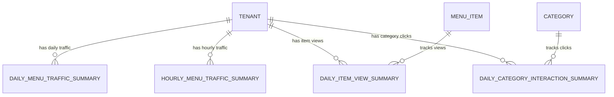

# Phase 1 Data Model: Menu Analytics, Interaction Telemetry and Menu Engineering Dashboard

**Feature**: `011-menu-analytics-and-telemetry`  
**Date**: 2026-11-04

---

## 1. Domain Entity Extensions

### 1.1 `MenuItem` (`src/RestoCore.Domain/Entities/MenuItem.cs`)
Adds optional estimated production cost to support contribution margin calculation in the Menu Engineering Matrix:

| Property | Type | Nullable | Default | Description |
|----------|------|----------|---------|-------------|
| `EstimatedCost` | `decimal?` | Yes | `null` | Estimated ingredient/production cost per unit. When `null`, defaults to `30%` of `BasePrice` (`FR-007`). |

### 1.2 `Tenant` (`src/RestoCore.Domain/Entities/Tenant.cs`)
Adds subscription tier classification to control conditional exposure of Level 2 (Pro Plan) analytics (`FR-008`):

| Property | Type | Nullable | Default | Description |
|----------|------|----------|---------|-------------|
| `PlanTier` | `string` | No | `"Standard"` | Subscription plan tier (`"Standard"`, `"Pro"`, `"Enterprise"`). |

---

## 2. New Analytics Roll-Up Entities (`src/RestoCore.Domain/Entities/`)

To guarantee `< 300ms p95` dashboard queries (`SC-002`) and Zero PII storage (`FR-003`, `SC-004`), telemetry events are aggregated into tenant-scoped roll-up entities in PostgreSQL.

### 2.1 `DailyMenuTrafficSummary`
Stores daily QR menu open counts and device type breakdowns per tenant.

| Property | Type | Constraints | Description |
|----------|------|-------------|-------------|
| `Id` | `Guid` | PK | Unique identifier |
| `TenantId` | `Guid` | FK (`tenants.id`), Indexed, Required | Owning tenant identifier |
| `DateUtc` | `DateOnly` | Indexed (`UNIQUE(TenantId, DateUtc)`) | UTC calendar date of traffic |
| `QrVisitsCount` | `int` | `>= 0`, Default `0` | Total `menu_view` events recorded on `DateUtc` |
| `MobileCount` | `int` | `>= 0`, Default `0` | Events originating from `mobile` devices |
| `DesktopCount` | `int` | `>= 0`, Default `0` | Events originating from `desktop` devices |
| `TabletCount` | `int` | `>= 0`, Default `0` | Events originating from `tablet` devices |

### 2.2 `DailyItemViewSummary`
Stores daily view counts (`item_view`) per dish and tenant.

| Property | Type | Constraints | Description |
|----------|------|-------------|-------------|
| `Id` | `Guid` | PK | Unique identifier |
| `TenantId` | `Guid` | FK (`tenants.id`), Indexed, Required | Owning tenant identifier |
| `ItemId` | `Guid` | FK (`menu_items.id`), Indexed, Required | Target dish identifier |
| `DateUtc` | `DateOnly` | Indexed (`UNIQUE(TenantId, ItemId, DateUtc)`) | UTC calendar date |
| `ViewsCount` | `int` | `>= 0`, Default `0` | Total `item_view` events on `DateUtc` |

### 2.3 `DailyCategoryInteractionSummary`
Stores daily interaction counts (`category_click`) per category and tenant.

| Property | Type | Constraints | Description |
|----------|------|-------------|-------------|
| `Id` | `Guid` | PK | Unique identifier |
| `TenantId` | `Guid` | FK (`tenants.id`), Indexed, Required | Owning tenant identifier |
| `CategoryId` | `Guid` | FK (`categories.id`), Indexed, Required | Target category identifier |
| `DateUtc` | `DateOnly` | Indexed (`UNIQUE(TenantId, CategoryId, DateUtc)`) | UTC calendar date |
| `InteractionsCount` | `int` | `>= 0`, Default `0` | Total `category_click` events on `DateUtc` |

### 2.4 `HourlyMenuTrafficSummary`
Stores hourly visit counts (`0..23` UTC) per tenant and date to power Pro Plan peak-hour demand curves (`FR-008`).

| Property | Type | Constraints | Description |
|----------|------|-------------|-------------|
| `Id` | `Guid` | PK | Unique identifier |
| `TenantId` | `Guid` | FK (`tenants.id`), Indexed, Required | Owning tenant identifier |
| `DateUtc` | `DateOnly` | Indexed, Required | UTC calendar date |
| `HourOfDay` | `int` | `0..23` (`UNIQUE(TenantId, DateUtc, HourOfDay)`) | Hour of day (0 to 23) |
| `VisitsCount` | `int` | `>= 0`, Default `0` | Total visits during that hour |

---

## 3. Ephemeral Queue Message Model

### 3.1 `AnalyticsEventMessage` (Application DTO / Queue Payload)
Buffered in memory / Redis Stream between `POST /api/v1/analytics/collect` and `AnalyticsAggregationWorker`:

- `TenantId` (`Guid`)
- `EventType` (`string`: `"menu_view" | "item_view" | "category_click"`)
- `ItemId` (`Guid?`)
- `CategoryId` (`Guid?`)
- `DeviceType` (`string?`: `"mobile" | "desktop" | "tablet"`)
- `OccurredAtUtc` (`DateTimeOffset`)

> **Privacy Invariant (`FR-003`)**: Neither `AnalyticsEventMessage` nor any database table contains client IP addresses, User-Agent strings, cookies, or `table_token` occupancy state.

---

## 4. Entity Relationship Diagram

